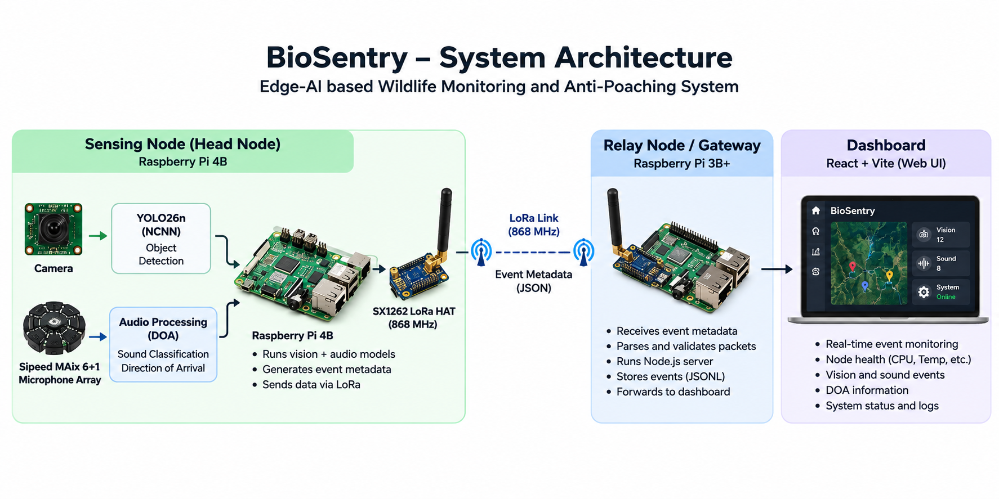
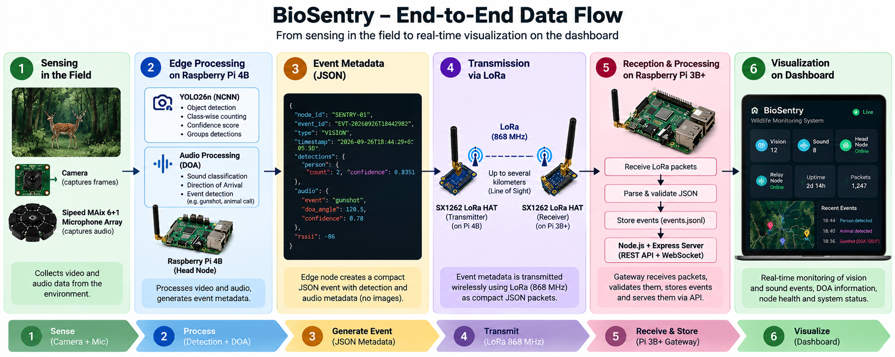
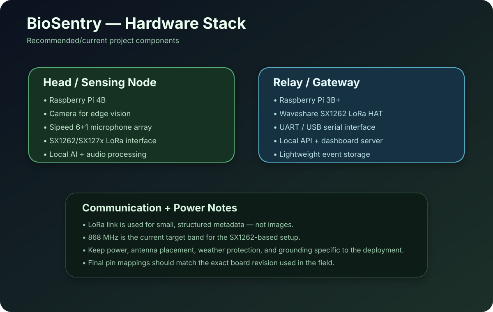
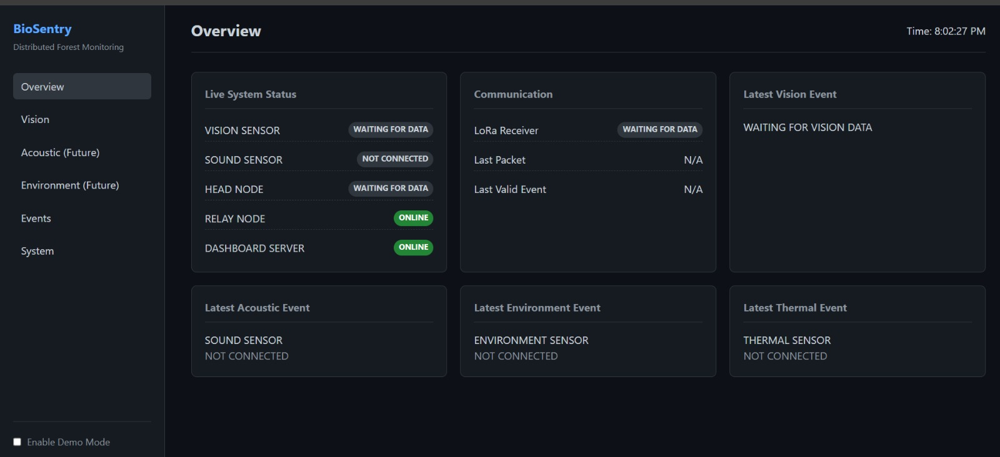

# BioSentry 🐾

> **Edge-AI wildlife monitoring and anti-poaching system using computer vision, acoustic intelligence, DOA processing, LoRa telemetry, and a lightweight local dashboard.**

BioSentry is a distributed wildlife-monitoring prototype designed to detect and report suspicious human/object activity and acoustic events at the edge. The system performs computation close to the sensing location, converts detections into compact metadata, forwards that metadata over a low-bandwidth LoRa link, and presents the resulting events through a lightweight local dashboard.

The project is intentionally designed around a practical field constraint: **do not send large images or raw audio over LoRa**. Instead, BioSentry sends structured event metadata such as node ID, event type, timestamp, detected object class, confidence, and sound/DOA information.

---

## 📸 Visual Overview

### System architecture



### End-to-end data flow



### Hardware stack



### Dashboard concept / module layout




---

## 🎯 Problem Statement

Wildlife protection systems often face a difficult combination of requirements:

- Remote deployment areas with unreliable or unavailable internet connectivity.
- Limited compute and memory on edge devices.
- Low-bandwidth communication links.
- Need for near-real-time alerts.
- Need to detect both **visual activity** and **acoustic events**.
- Need to operate continuously without streaming raw multimedia to a central server.

BioSentry addresses these constraints by combining **edge AI + acoustic sensing + LoRa telemetry + local monitoring** into a modular pipeline.

---

## 💡 What BioSentry Does

At a high level, the system:

1. Captures visual and acoustic information at an edge node.
2. Runs local AI / signal-processing workloads.
3. Extracts useful metadata from the raw sensor signals.
4. Packages the result into structured JSON events.
5. Sends compact metadata through a LoRa link.
6. Receives the packets at a relay/gateway node.
7. Stores events locally in a lightweight JSONL event stream.
8. Exposes REST APIs and WebSocket updates.
9. Displays node health and detection metadata in a local dashboard.

---

## 🧠 Core Features

### 1. Edge-AI Vision

BioSentry uses **YOLO26n with an NCNN interface** for efficient object detection on Raspberry Pi hardware. The edge node converts the detector output into a compact event rather than transmitting full images.

Example detection classes used during testing include:

- person
- bicycle
- car
- motorcycle
- bird
- cat
- dog
- cow

The event payload can aggregate detections, for example:

```json
{
  "detections": {
    "person": {
      "count": 2,
      "confidence": 0.8351
    }
  }
}
```

### 2. Acoustic Monitoring

A **Sipeed MAix 6+1 microphone array** is used as the acoustic sensing interface. The audio pipeline is intended to provide event-level information and source-direction information without requiring raw audio to be transported through the LoRa link.

### 3. Direction of Arrival (DOA)

BioSentry includes a **Direction of Arrival (DOA)** processing stage for estimating the direction of an acoustic source from the microphone array.

The current project direction is:

```text
Microphone Array
      ↓
Audio acquisition
      ↓
Pre-processing
      ↓
DOA estimation
      ↓
Source direction metadata
      ↓
LoRa event packet
```

### 4. LoRa Telemetry

The sensing node forwards compact metadata over a LoRa link. The current hardware work targets an **SX1262-based 868 MHz setup**.

Only small structured packets should cross the field link. Images, long audio recordings, and other large payloads stay local to the edge node.

### 5. Relay / Gateway

A Raspberry Pi 3B+ acts as the relay/gateway and hosts the lightweight server side of the system.

The gateway currently handles:

- LoRa packet reception
- packet decoding
- event persistence
- REST API access
- WebSocket updates
- dashboard hosting
- node/system status

### 6. Lightweight Dashboard

The dashboard is deliberately kept lightweight because it is designed to run on a **Raspberry Pi 3B+ with 1 GB RAM**.

The UI focuses on:

- live vision status
- sound sensor status
- latest events
- detection counts
- confidence values
- head-node CPU and temperature
- last transmission
- relay packets forwarded
- dashboard server status
- IP address and uptime

The dashboard displays **metadata**, not a continuous image stream.

---

## 🏗️ System Architecture

```text
                         ┌───────────────────────────┐
                         │        FIELD / EDGE       │
                         │                           │
                         │  Camera + Microphones     │
                         │           │               │
                         │           ▼               │
                         │     Raspberry Pi 4B       │
                         │                           │
                         │  YOLO26n + NCNN           │
                         │  Acoustic processing      │
                         │  DOA estimation           │
                         │           │               │
                         │     Event JSON            │
                         └───────────┬───────────────┘
                                     │
                              LoRa / 868 MHz
                                     │
                                     ▼
                         ┌───────────────────────────┐
                         │     RELAY / GATEWAY       │
                         │     Raspberry Pi 3B+      │
                         │                           │
                         │  SX1262 LoRa bridge      │
                         │  Node.js / Express        │
                         │  JSONL event storage      │
                         │  REST + WebSocket         │
                         └───────────┬───────────────┘
                                     │
                              HTTP / WebSocket
                                     │
                                     ▼
                         ┌───────────────────────────┐
                         │       DASHBOARD           │
                         │      React / Vite         │
                         │                           │
                         │  Events + telemetry       │
                         │  Vision + sound status    │
                         │  Node health              │
                         └───────────────────────────┘
```

---

## 🔄 Event Processing Pipeline

```text
Sensor Input
    │
    ├── Vision ──► YOLO26n / NCNN ──► object detections
    │
    └── Audio  ──► microphone array ─► DOA / sound metadata
                              │
                              ▼
                     Event Normalization
                              │
                              ▼
                         JSON Payload
                              │
                              ▼
                     LoRa Transmission
                              │
                              ▼
                       Relay / Gateway
                              │
                     ┌────────┴────────┐
                     ▼                 ▼
                 JSONL Store       REST / WS
                                       │
                                       ▼
                                   Dashboard
```

---

## 📦 Example Event Payload

A representative vision packet currently used during testing is:

```json
{
  "node_id": "SENTRY-01",
  "event_id": "EVT-20260926T18442982",
  "type": "VISION",
  "timestamp": "2026-09-26T18:44:29.826883+05:30",
  "detections": {
    "person": {
      "count": 2,
      "confidence": 0.8351
    }
  }
}
```

### Payload fields

| Field | Meaning |
|---|---|
| `node_id` | Unique sensing-node identifier |
| `event_id` | Unique event identifier |
| `type` | Event category such as `VISION` or `SOUND` |
| `timestamp` | Time at which the event was generated |
| `detections` | Aggregated object-detection metadata |
| `count` | Number of detected instances |
| `confidence` | Model confidence associated with the detection |

The schema can be extended with acoustic and telemetry fields such as source direction, RSSI, SNR, sensor status, or battery data.

---

## 🧰 Technology Stack

### Edge / AI

| Area | Technology |
|---|---|
| Edge computer | Raspberry Pi 4B |
| Object detection | YOLO26n |
| Inference interface | NCNN |
| Acoustic sensing | Sipeed MAix 6+1 microphone array |
| Signal processing | Python / numerical processing tools |
| DOA | Acoustic direction-of-arrival processing |

### Communication / Gateway

| Area | Technology |
|---|---|
| Radio | SX1262-based LoRa |
| Target band | 868 MHz |
| Relay computer | Raspberry Pi 3B+ |
| Serial interface | UART / USB serial, depending on hardware configuration |

### Backend / Dashboard

| Area | Technology |
|---|---|
| Backend | Node.js |
| API | Express |
| Real-time updates | WebSocket |
| Data format | JSON / JSONL |
| Frontend | React + Vite |
| Dashboard deployment | Local / Raspberry Pi |

---

## 🔩 Hardware

### Current hardware architecture

**Head node**

- Raspberry Pi 4B
- Camera / vision sensor
- Sipeed MAix 6+1 microphone array
- LoRa radio interface

**Relay / gateway**

- Raspberry Pi 3B+
- Waveshare SX1262 LoRa HAT / interface
- Local Ethernet/Wi-Fi connection for dashboard access

### Important deployment considerations

The final physical deployment should document the exact:

- Raspberry Pi board revision
- LoRa board revision
- antenna model and connector
- microphone mounting position
- GPIO/UART mapping
- power supply
- weatherproof enclosure
- grounding and cable routing

> **Do not blindly copy GPIO numbers from a different board revision.** Verify the exact board pinout before field wiring.

---

## 🗂️ Suggested Repository Structure

The current project is organized around a gateway/dashboard implementation similar to:

```text
BioSentry/
│
├── backend/
│   ├── server.js
│   ├── api/
│   │   └── index.js
│   ├── storage/
│   │   └── reader.js
│   └── utils/
│       └── validation.js
│
├── gateway/
│   └── lora_bridge.py
│
├── frontend/
│   ├── index.html
│   ├── styles.css
│   └── app.js
│
├── data/
│   ├── events/
│   │   └── events.jsonl
│   └── status.json
│
├── vision/
│   └── ...
│
├── audio/
│   └── ...
│
├── doa/
│   └── ...
│
├── docs/
│   └── images/
│       ├── architecture.svg
│       ├── data-flow.svg
│       ├── hardware-stack.svg
│       └── dashboard-overview.svg
│
├── README.md
└── docker-compose.yml
```

> Rename or remove folders above to match the exact repository layout before publishing the final version.

---

## 🚀 Getting Started

Because BioSentry contains several hardware-dependent services, there are two sensible ways to run it:

1. **Dashboard / gateway only** for software development.
2. **Full edge deployment** on the Raspberry Pi hardware.

### 1. Clone the repository

```bash
git clone <YOUR_REPOSITORY_URL>
cd BioSentry
```

### 2. Backend dependencies

```bash
cd backend
npm install
```

### 3. Start the gateway / dashboard server

Use the actual project start script defined in `package.json`. For the current server implementation, the expected result is similar to:

```text
BioSentry Dashboard running on port 8080
```

Then test:

```bash
curl http://localhost:8080/api/health
```

and:

```bash
curl http://localhost:8080/api/system/status
```

### 4. Start the LoRa bridge

The LoRa bridge reads the serial interface connected to the SX126x hardware and converts received packets into event records.

Typical Linux serial discovery:

```bash
ls /dev/ttyUSB*
ls /dev/ttyACM*
```

The project has been tested with a serial interface such as:

```text
/dev/ttyUSB0
```

Before starting the bridge, confirm the actual device path on the target Raspberry Pi.

### 5. Example serial configuration

For the tested UART/USB setup, serial parameters may be configured similar to:

```bash
stty -F /dev/ttyUSB0 9600 cs8 -cstopb -parenb -crtscts
```

> Use the serial configuration required by the exact LoRa board and firmware in your deployment. Do not assume `9600` applies to every LoRa module.

---

## 🌐 API Endpoints

The gateway/dashboard server currently exposes endpoints in this family:

| Endpoint | Purpose |
|---|---|
| `GET /api/health` | Basic server health check |
| `GET /api/system/status` | Node/server status information |
| `GET /api/latest` | Latest event/packet information |
| `GET /api/events` | Event history / event data |

Example:

```bash
curl http://localhost:8080/api/health
```

```bash
curl http://localhost:8080/api/latest
```

The exact response schema should be treated as the source of truth from the implementation in `backend/api/index.js`.

---

## 📡 LoRa Bridge

The gateway includes a Python LoRa bridge that:

1. Opens the LoRa serial interface.
2. Reads raw received bytes.
3. Extracts the JSON payload from the radio frame.
4. Validates / normalizes the event where required.
5. Appends the event to the JSONL event store.
6. Makes the data available to the local dashboard/API.

This design keeps the LoRa layer independent from the web dashboard and makes it possible to test the dashboard with recorded or simulated events.

---

## 🧪 Simulation / Testing

A software simulation can be used before connecting the actual radios.

### Example simulated event

```json
{
  "node_id": "SENTRY-01",
  "event_id": "SIM-001",
  "type": "VISION",
  "timestamp": "2026-10-06T00:00:00+05:30",
  "detections": {
    "person": {
      "count": 1,
      "confidence": 0.91
    }
  }
}
```

Save test events into the project's event stream and verify that:

- the JSON is accepted,
- the dashboard shows the event,
- `/api/latest` returns the latest record,
- `/api/events` exposes event history,
- the system status remains healthy.

---

## 🐳 Docker Support

Docker Compose has been used for development and simulation of the BioSentry services.

A typical development flow is:

```bash
docker compose build
docker compose up
```

For a clean restart after stale containers:

```bash
docker compose down

docker compose up --build
```

If an old container name is blocking the compose deployment, inspect running containers with:

```bash
docker ps -a
```

and remove only the stale container that belongs to the BioSentry development environment.

---

## 🧠 Memory / Resource Optimization

The Raspberry Pi 3B+ has only **1 GB RAM**, so the project avoids unnecessary heavy processing on the gateway.

One important optimization is the event-storage reader: instead of repeatedly loading the entire `events.jsonl` file into memory, the implementation should read only what is needed for the current request.

This matters because event logs can grow continuously during field operation.

### Design rule

```text
Heavy AI workload → Pi 4B / sensing node

Lightweight networking + API + dashboard → Pi 3B+ / gateway
```

---

## 📊 Dashboard Monitoring Model

The dashboard is intended to answer five basic operational questions quickly:

| Area | Examples |
|---|---|
| Vision | Is the camera/vision pipeline alive? What was detected? |
| Sound | Is acoustic sensing alive? What direction/event was reported? |
| Head node | CPU, temperature, last transmission |
| Relay node | Packets forwarded, connection state |
| Server | Health, IP, uptime, latest event |

This makes the UI suitable for local monitoring without turning the gateway into a heavy analytics server.

---

## 🔐 Security Notes

BioSentry is currently designed primarily as a local/field prototype. Before internet exposure or production deployment, add:

- authentication for dashboard/API access
- API authorization
- TLS/HTTPS where applicable
- input validation for every external packet
- rate limiting
- signed/authenticated event messages
- secure secrets handling
- firewall rules
- restricted SSH access
- log rotation and retention policies

Never store passwords, tokens, private keys, or `.env` secrets in the repository.

Add sensitive files to `.gitignore`:

```gitignore
.env
*.pem
*.key
id_rsa*
__pycache__/
node_modules/
*.log
```

---

## 🛠️ Troubleshooting

### `cannot find /dev/ttyUSB0`

Check the serial devices:

```bash
ls /dev/ttyUSB*
ls /dev/ttyACM*
```

Then update the configured port.

### Serial permission denied

Check the device permissions and your user groups:

```bash
ls -l /dev/ttyUSB0
```

On Raspberry Pi/Linux systems, the user may need access to the serial device group.

### Docker container conflict

```bash
docker ps -a
```

Stop/remove only the stale BioSentry container, then restart the compose stack.

### Dashboard memory usage grows

Check whether any endpoint or storage reader is loading the complete JSONL event history into RAM. Use bounded reads, pagination, tail-based reads, or rotation instead.

### LoRa packets contain unexpected bytes

Inspect the raw serial frame first. The bridge should isolate the JSON payload rather than assuming every byte received belongs to the application-level message.

### Dashboard is reachable but no events appear

Check the pipeline in this order:

```text
Sensor
  ↓
AI / audio processing
  ↓
JSON event generated?
  ↓
LoRa TX
  ↓
LoRa RX / bridge
  ↓
events.jsonl updated?
  ↓
/api/latest
  ↓
Dashboard
```

---

## 🧭 Development Roadmap

### ✅ Current / implemented direction

- [x] Raspberry Pi edge architecture
- [x] Vision metadata pipeline
- [x] YOLO26n + NCNN integration direction
- [x] Acoustic sensing / DOA work
- [x] LoRa metadata transport
- [x] Relay/gateway node
- [x] Local JSONL event storage
- [x] REST API
- [x] WebSocket-based update path
- [x] Lightweight dashboard
- [x] Resource-aware gateway storage logic
- [x] Docker-based simulation/development

### 🔜 Future improvements

- [ ] Multi-node acoustic triangulation
- [ ] More robust synchronization between sensing nodes
- [ ] Thermal / infrared sensor integration
- [ ] Environmental sensors
- [ ] Battery / solar telemetry
- [ ] Geospatial event visualization
- [ ] Alert severity scoring
- [ ] Store-and-forward buffering for temporary link loss
- [ ] Message authentication / encryption strategy
- [ ] Remote fleet management
- [ ] Long-term wildlife analytics and reporting

---

## 🌲 Why Edge + LoRa?

BioSentry deliberately separates **high-bandwidth sensing** from **low-bandwidth communication**.

```text
RAW SENSOR DATA
     │
     ▼
┌──────────────────────┐
│   EDGE PROCESSING    │
│  AI + Audio + DOA    │
└──────────┬───────────┘
           │
           ▼
   SMALL EVENT METADATA
           │
           ▼
     LoRa / 868 MHz
           │
           ▼
       GATEWAY
           │
           ▼
      DASHBOARD
```

This approach reduces communication overhead, keeps sensitive raw sensor data local, and allows the gateway hardware to remain relatively lightweight.

---

## 🔬 Research / Engineering Scope

BioSentry sits at the intersection of several engineering domains:

- **Computer Vision** — object detection at the edge
- **Embedded AI** — optimized inference on constrained hardware
- **Digital Signal Processing** — acoustic feature extraction
- **DOA Estimation** — determining the direction of sound sources
- **IoT Communication** — LoRa-based telemetry
- **Distributed Systems** — sensing node → relay → dashboard
- **Backend Engineering** — REST + WebSocket APIs
- **Systems Engineering** — memory, CPU, serial, and reliability constraints

---

## 👨‍💻 Project Structure Philosophy

BioSentry is easier to evolve when each responsibility remains modular:

```text
vision/      → camera + object detection

audio/       → microphone acquisition / features

doa/         → source-direction estimation

gateway/     → LoRa receive / packet bridge

backend/     → API + storage + validation

frontend/    → monitoring dashboard

data/       → local event/status data
```

The benefit is that individual subsystems can be simulated, tested, or replaced without redesigning the complete system.

---

## 📌 Important Notes

This repository documents an evolving research/engineering prototype. Hardware revisions, firmware settings, model files, GPIO mappings, and deployment commands should always be verified against the exact components used in the current field build.

Large model weights, raw datasets, long recordings, and generated logs should not be committed directly to Git unless there is a deliberate reason to version them. Prefer release assets, Git LFS, cloud/object storage, or documented download steps for large files.

---

## ⭐ BioSentry in One Line

> **BioSentry transforms edge vision and acoustic sensing into compact, LoRa-delivered wildlife intelligence that can be monitored locally on resource-constrained hardware.**
